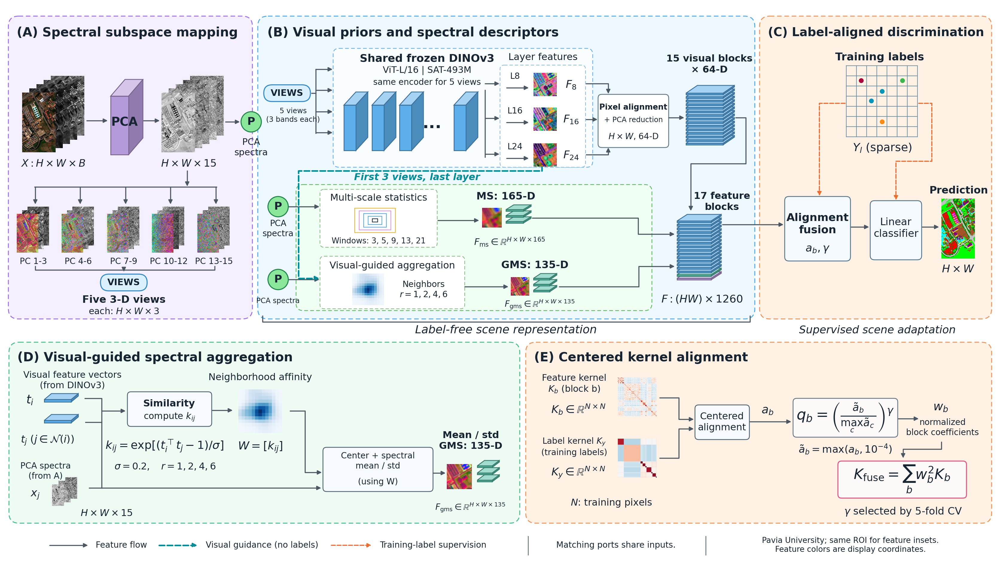

# ATOF

**Bridging Spectral and Visual Spaces: Multi-Subspace Transfer for Few-Shot Hyperspectral Classification**

Research implementation of multi-subspace frozen visual transfer, local spectral
description, and alignment-tempered fusion for few-shot hyperspectral classification.



## Method

1. Project the hyperspectral scene onto 15 principal components and construct
   five consecutive three-channel views.
2. Extract layers 8, 16, and 24 with a shared DINOv3 ViT-L/16 SAT-493M encoder;
   align features to the pixel grid and reduce each view–layer block to 64 dimensions.
3. Add multiscale spectral statistics (MS) and visual-guided statistics (GMS).
4. Select fusion strength by five-fold validation, estimate centered kernel-target
   alignment from training labels, and fit a class-balanced linear classifier.

The main representation has 17 blocks and 1260 dimensions. PCA, encoding, and
feature normalization use the full unlabeled scene: this is **transductive,
scene-level classification**. Test labels are used only for evaluation.

## Installation

Python 3.10+ is recommended. Install a CUDA-compatible PyTorch build for feature
extraction, then run:

```bash
python -m pip install -r requirements.txt
```

Use a timm version providing `vit_large_patch16_dinov3.sat493m`. Model weights may
require upstream access authorization. Feature extraction uses substantial GPU
memory; cached classification runs on CPU. Exact original package versions were
not recorded, so `requirements.txt` is a dependency list, not a historical lockfile.

## Data

See [data/README.md](data/README.md) for filenames, array keys, dimensions, and
workspace configuration. Data, checkpoints, dense feature caches, and local
credentials are excluded from version control.

## Main experiment

Run from the repository root, first preparing label-free features and then fitting
the classifier. Repeat for `HUS` and `PU`:

```bash
python run_experiments.py --dataset PU --prepare
python run_experiments.py --dataset PU --experiment main
python run_experiments.py --dataset HUS --prepare
python run_experiments.py --dataset HUS --experiment main
```

`--prepare` runs PCA/statistics, frozen satellite feature extraction, and GMS
construction using the first three satellite views at layer 24. Outputs are cached
under `results/feats/`; classifier records are written to `results/ours/<tag>/`.
Existing outputs are skipped. Use `--dry-run` to inspect commands.

## Ablations and additional protocols

```bash
python run_experiments.py --dataset PU --suite ablation
python run_experiments.py --dataset HUS --suite views
python run_experiments.py --dataset HUS --experiment official
python run_experiments.py --dataset PU --experiment n5
python run_experiments.py --dataset PU --experiment n40
```

| Table configuration | Experiment tag | Description |
|---|---|---|
| A1 | `abl_spec` | Center spectrum |
| A2 | `abl_ms` | Multiscale statistics |
| A3 | `abl_ms_gms` | MS and GMS |
| A4 | `abl_tok` | Visual features |
| A5 | `abl_tok_ms` | Visual features + MS |
| A6 | `abl_tok_gms` | Visual features + GMS |
| A7 | `fus_g0` | Complete features, equal fusion |
| A8 | `main` | ATOF |
| A9 | `abl_spec_full` | ATOF + independent center spectrum |

The view suite uses `abl_c0`, `abl_c02`, and `main`. MS/GMS remain available to
these variants. GMS uses visual guidance even in configurations without a direct
visual classification block. Additional archived configurations are described in
`configs/experiments.json`; alternative backbones/scales require their own caches.
The configuration file is derived from recorded run arguments.

## Recorded results

The repository includes original evaluation JSON records in `reported_results/`.
They are preserved separately from newly generated `results/`. Evaluation splits
are 10–19; label-budget studies use 10–14, and the official Houston split uses
10–12. Training/validation/test counts in the main protocol are
150/150/14,729 (Houston) and 85/86/42,605 (Pavia University).

| Dataset | Method | OA (%) | AA (%) | Kappa × 100 |
|---|---|---:|---:|---:|
| Houston | Matched LDMAN | 89.95 ± 1.92 | 90.40 ± 1.84 | 89.14 ± 2.08 |
| Houston | ATOF | **95.62 ± 1.03** | **95.78 ± 1.04** | **95.26 ± 1.12** |
| Pavia University | Matched LDMAN | 93.38 ± 1.45 | 89.34 ± 2.00 | 91.22 ± 1.92 |
| Pavia University | ATOF | **98.22 ± 1.01** | **97.51 ± 1.01** | **97.64 ± 1.36** |

These are recorded means ± sample standard deviations, not newly rerun GPU results.
ATOF uses external pretrained knowledge. Baselines use matched target-scene labels;
their pretraining budgets are not matched. Inspect the records without downloading
datasets or weights:

```bash
python summarize_results.py
python summarize_results.py --root results
```

## Source layout

`code/feat_v2.py`: frozen features; `build_feats.py`: MS; `build_guided.py`: GMS;
`method.py`: alignment and model selection; `core.py`: classifier;
`common.py`: data and splits; `run_ours.py`: evaluation;
`map_ours.py`: full-scene predictions; `run_ldman.py`: optional matched baseline.
The publication copy replaces the original machine-specific root with a portable
default and environment override. The numerical method is retained.

See [THIRD_PARTY.md](THIRD_PARTY.md) for pretrained-model and comparison-method
attribution. This repository accompanies a research manuscript; no acceptance or
publication status is implied.
